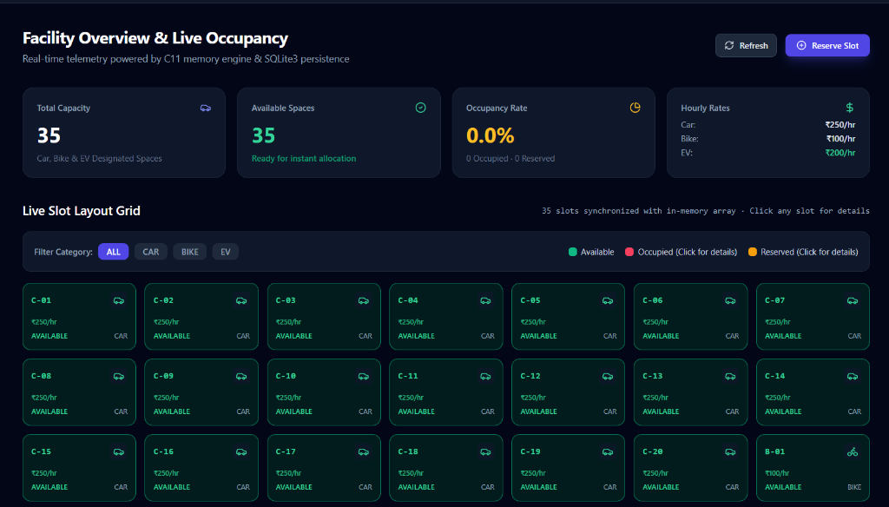
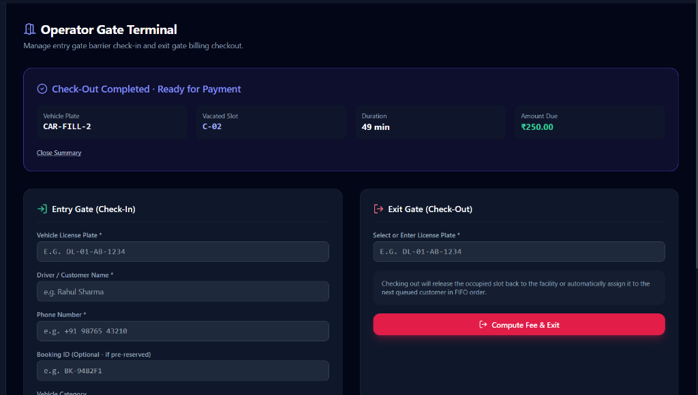
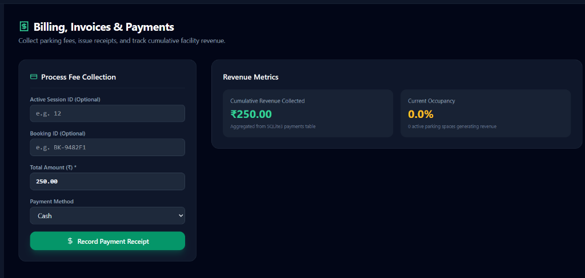
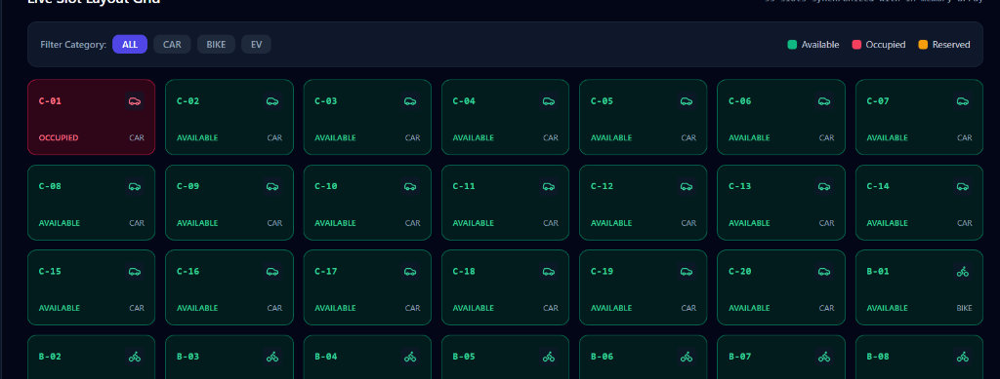
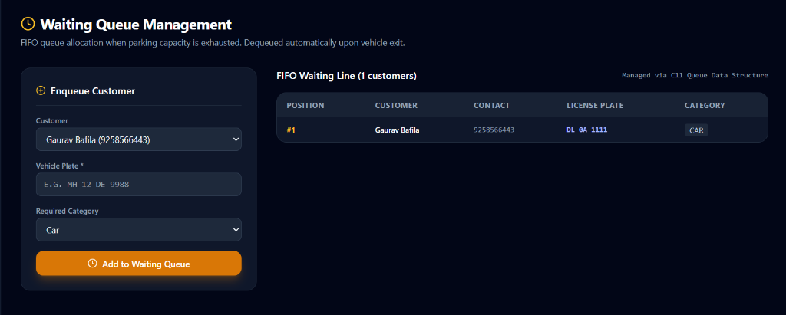
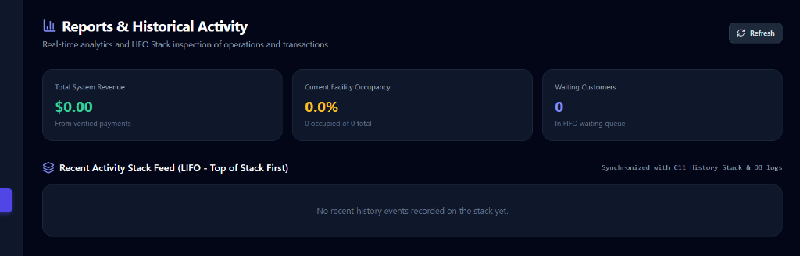
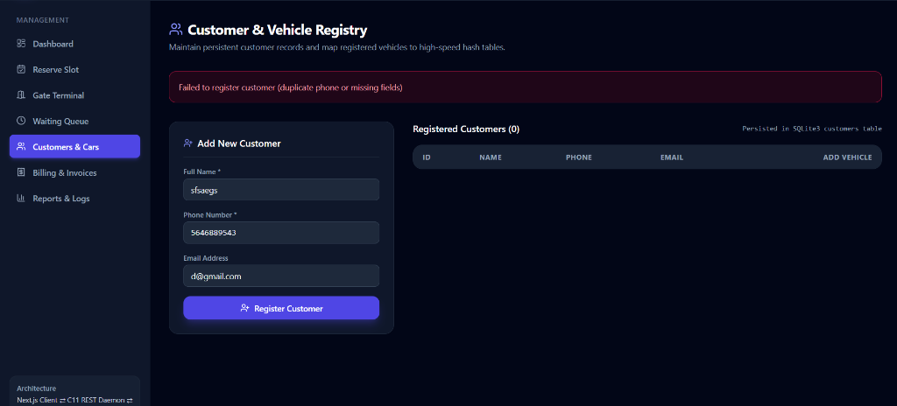
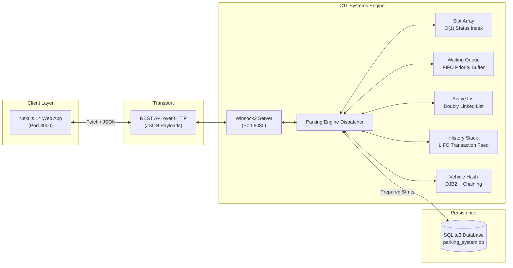

<div align="center">

# 🚗 Smart Parking Reservation & Management System

### *High-Performance Hybrid C11 Microserver & Next.js Real-Time Automation*

[](https://en.wikipedia.org/wiki/C11_(C_standard_revision))
[](https://nextjs.org/)
[](https://www.typescriptlang.org/)
[](https://tailwindcss.com/)
[](https://www.sqlite.org/)
[](https://github.com)

<p align="center">
  A full-stack, enterprise-grade parking facility automation platform designed for high throughput, sub-millisecond slot queries, and zero-friction cashier billing.
</p>

[Explore Features](#-feature-tour--screenshots) • [Architecture](#-architecture--data-structures) • [Quick Start](#-quick-start) • [API Reference](#-api-specification) • [Testing](#-automated-testing-suite)

---

</div>

## 📸 Feature Tour & Screenshots

### 1. Live Facility Overview & 2D Interactive Slot Grid
Real-time visual monitoring of all parking designated spaces (Car, Motorcycle/Bike, and EV Charging Stations). Inspect capacity, occupancy rate, and hourly rates in Indian Rupees (₹) with sub-second live updates.



---

### 2. Operator Gate Terminal (Check-In & Check-Out)
Fast entry gate barrier ticketing with mandatory driver contact validation, and exit checkout with a **smart vehicle selector** displaying driver names, license plates, and vacated slots.



---

### 3. Simplified Cashier Billing & Printable Receipts
Eliminates database IDs and technical friction! Cashiers pick an exiting vehicle, view auto-calculated rates (**Car: ₹250/hr, Bike: ₹100/hr, EV: ₹200/hr**), tap a payment method (**Cash / UPI / Card**), and print instant digital receipts.



---

### 4. Real-Time Slot Inspection Modal
Click any parking space on the live grid to inspect driver name, contact phone, vehicle license plate, entry timestamp, elapsed parking duration, and accrued charges.



---

### 5. FIFO Waiting Queue Management
Dynamic queue handling when capacity is exhausted. Features **1-click Direct Admission** into newly available slots and operator queue dismissal.



---

### 6. Reports, Revenue Metrics & LIFO Activity Stack
Auditable LIFO transaction stack and persistent SQLite3 log tracking entries, exits, fee collections, and occupancy analytics.



---

### 7. Customer & Vehicle Multi-Registry
Customer directory supporting multi-vehicle ownership, license plate format verification, and instantaneous lookup via hash indexing.



---

## 🌟 Key Highlights & Innovations

- **⚡ Blazing Fast C11 Backend**: Custom multithreaded Winsock HTTP microserver written in modern C11 with zero runtime overhead.
- **🧠 5 Core Data Structures**: Built from first principles in C without heavy frameworks (Arrays, Doubly Linked Lists, FIFO Queues, LIFO Stacks, DJB2 Hash Tables).
- **🇮🇳 Rupee-Centric Billing**: Pre-configured facility rates tailored to commercial Indian facilities:
  - 🚗 **Car**: ₹250.00 / hour
  - 🏍️ **Motorcycle / Bike**: ₹100.00 / hour
  - ⚡ **Electric Vehicle (EV)**: ₹200.00 / hour
- **🔄 Gate-to-Billing Seamless Flow**: Check-out at the gate calculates the exact parking duration and provides a 1-click **`Proceed to Payment`** button redirecting straight to pre-filled billing.
- **🛡️ Self-Healing Persistence**: Resilient SQLite3 engine with embedded schema auto-initialization, prepared statement parameterization, and transaction rollback atomicity.

---

## 🏛 Architecture & Data Structures



### Algorithmic Complexity

| Data Structure | Implementation File | Primary Purpose | Time Complexity |
| :--- | :--- | :--- | :---: |
| **Fixed Array** | `backend/src/slot_array.c` | Slot occupancy state and visual coordinate mapping | $\mathcal{O}(1)$ Lookup |
| **FIFO Queue** | `backend/src/waiting_queue.c` | Fair waiting customer queue when garage capacity is exhausted | $\mathcal{O}(1)$ Enqueue/Dequeue |
| **Doubly Linked List** | `backend/src/active_vehicles.c` | Active parked vehicles tracking & rapid departure removal | $\mathcal{O}(1)$ Insert / Delete |
| **LIFO Stack** | `backend/src/history_stack.c` | Operations undo stack and recent audit activity feed | $\mathcal{O}(1)$ Push / Pop |
| **Hash Table** | `backend/src/vehicle_hash.c` | Vehicle plate indexing with DJB2 algorithm and chaining | $\mathcal{O}(1)$ Average Search |

---

## 🚀 Quick Start

### Prerequisites
- **GCC (MinGW-w64)** supporting C11 (`gcc --version`)
- **Node.js** v18+ & **npm** (`node -v`)
- **Windows OS** (Uses native Winsock2 and SQLite3)

---

### Option 1: 1-Click Automated Startup (Recommended)
Launch both the backend microserver and frontend Next.js dev server simultaneously:

```powershell
powershell -ExecutionPolicy Bypass -File .\start-all.ps1
```

---

### Option 2: Step-by-Step Manual Startup

#### Step 1: Build & Start C11 Backend Server
```powershell
# Compile C11 backend binary into backend/server.exe
powershell -ExecutionPolicy Bypass -File .\backend\build.ps1

# Start the server on port 8080
.\backend\server.exe 8080
```
*Backend will listen at `http://127.0.0.1:8080`.*

#### Step 2: Start Next.js Frontend
In a new terminal window:
```powershell
# Run directly from the root repository
npm.cmd run dev

# Or navigate to frontend folder
cd frontend
npm run dev
```

Open your browser at:
👉 **[http://localhost:3000](http://localhost:3000)**

---

## 🧪 Automated Testing Suite

The project includes unit, integration, and full end-to-end regression suites:

```powershell
# 1. Automated API Integration Test Suite (17 Endpoints)
powershell -ExecutionPolicy Bypass -File .\tests\test_api.ps1

# 2. Mandatory 13-Step Full E2E Workflow Test Suite
powershell -ExecutionPolicy Bypass -File .\tests\test_e2e_13steps.ps1

# 3. Core Engine & Data Structures C11 Test Suites
.\tests\test_services.exe
.\tests\test_data_structures.exe
.\tests\test_db.exe
```

### Test Results Breakdown
```
==========================================================
 EXECUTING MANDATORY 13-STEP E2E WORKFLOW VERIFICATION   
==========================================================
[Step 1/13] Configure parking facility and slots ... [PASS]
[Step 2/13] Register customer and vehicle ... [PASS]
[Step 3/13] Search for available CAR slot ... [PASS] (Found C-01)
[Step 4/13] Create and confirm valid reservation ... [PASS] (Booking: BK-412103E9)
[Step 5/13] Record vehicle entry at gate ... [PASS] (Assigned to C-01)
[Step 6/13] Verify active vehicle records in linked list ... [PASS]
[Step 7/13] Fill remaining capacity & verify FIFO queue ... [PASS] (Queued at pos 1)
[Step 8/13] Record vehicle exit & auto-allocate slot ... [PASS]
[Step 9/13] Calculate parking fee ... [PASS] (₹250.00 / hr)
[Step 10/13] Record payment transaction & receipt ... [PASS]
[Step 11/13] Verify parking history stack & hash search ... [PASS]
[Step 12/13] Generate reports from persistent database ... [PASS]
[Step 13/13] Restart C11 server & verify persistence ... [PASS]
==========================================================
 100% OF MANDATORY 13-STEP E2E CRITICAL WORKFLOW PASSED!  
==========================================================
```

---

## 📡 API Specification

| Endpoint | Method | Description |
| :--- | :---: | :--- |
| `/api/health` | `GET` | Health check and server status |
| `/api/facility` | `GET` | Current capacity, slot counts, and hourly rates in ₹ |
| `/api/facility/config` | `POST` | Dynamically reconfigure slot counts and rates |
| `/api/slots` | `GET` | Filter slots by `category` (`CAR`, `BIKE`, `EV`) or `status` |
| `/api/slots/detail` | `GET` | Retrieve complete driver, vehicle, and duration for any slot |
| `/api/customers` | `GET / POST` | Customer directory listing and registration |
| `/api/vehicles` | `POST` | Register a new vehicle to an existing customer |
| `/api/vehicles/search`| `GET` | High-speed $O(1)$ search by license plate |
| `/api/reservations` | `POST` | Create a confirmed slot reservation with unique Booking ID |
| `/api/reservations/cancel`| `POST` | Cancel a reservation and release the reserved slot |
| `/api/parking/entry` | `POST` | Gate barrier check-in (validates name, phone, plate) |
| `/api/parking/exit` | `POST` | Exit checkout, duration calculation, and queue trigger |
| `/api/parking/active` | `GET` | Inspect all actively parked vehicles |
| `/api/queue` | `GET` | View current FIFO waiting line |
| `/api/queue/join` | `POST` | Join the waiting queue |
| `/api/queue/admit` | `POST` | 1-click admit waiting vehicle into an available slot |
| `/api/queue/leave` | `POST / DELETE`| Dismiss or remove a customer from the queue |
| `/api/payments` | `POST` | Collect parking fee by plate and issue digital receipt |
| `/api/history` | `GET` | Retrieve real-time LIFO activity stack audit feed |
| `/api/reports/summary`| `GET` | Revenue metrics, total occupancy %, and active capacity |

---

## 📂 Repository Structure

```
Smart Parking Reservation & Management System/
├── backend/
│   ├── include/          # C11 Header definitions (structures.h, db.h, etc.)
│   ├── src/              # C11 Source files (engine, HTTP server, data structures)
│   ├── build.ps1         # Backend build script using MinGW GCC
│   └── server.exe        # Compiled high-speed Windows executable
├── frontend/
│   ├── app/              # Next.js 14 App Router pages
│   │   ├── page.tsx      # Live Dashboard & 2D Interactive SlotGrid
│   │   ├── gate/         # Gate Terminal Check-In & Exit Checkout
│   │   ├── billing/      # Simplified Cashier Billing & Receipts
│   │   ├── queue/        # FIFO Waiting Line Management
│   │   ├── reserve/      # Advance Slot Reservation
│   │   ├── customers/    # Customer & Vehicle Registry
│   │   └── reports/      # Historical Activity & Analytics
│   ├── lib/              # TypeScript API client & interface types
│   └── package.json      # Frontend npm dependencies
├── database/
│   ├── schema.sql        # SQLite3 table definitions and constraints
│   └── seed.sql          # Seed data for facility initialization
├── docs/
│   └── screenshots/      # High-resolution screenshots of the UI
├── tests/                # Automated PowerShell & C11 test suites
├── package.json          # Root npm script delegation
├── start-all.ps1         # 1-Click full-stack startup script
└── README.md             # Project documentation
```

---

## 📄 License
This project is open-source and available under the **MIT License**.
Feel free to fork, customize, and deploy!
